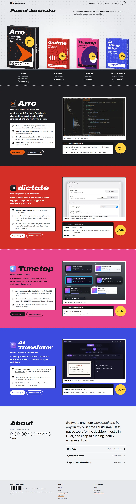

# pablosensei.github.io

The personal site of Paweł Januszko, served by GitHub Pages at <https://pablosensei.github.io>.
The home page lists the public projects; Arro has its own section with an overview and downloads,
a changelog, help and a roadmap.

Plain HTML, CSS and JavaScript. No framework, no build step, no dependencies.



Updating the version of another project (dictate, Tunetop, AI Translator) is a manual edit in
`index.html`: its box back, its spread and its download link.

## Refresh the Arro changelog after a release

```sh
node scripts/changelog.mjs
```

Node 18 or newer. The script reads every release of `PabloSensei/arro` from the GitHub API
(a token from `GITHUB_TOKEN`, `GH_TOKEN` or `gh auth token` is used when present; the public API
works without one) and then:

- writes `data/arro-releases.json`;
- rewrites the release list in `arro/changelog/index.html` (between `<!-- releases:start -->` and
  `<!-- releases:end -->`), so the changelog works without JavaScript;
- rewrites the download table in `arro/index.html` (between `<!-- downloads:start -->` and
  `<!-- downloads:end -->`) from the assets of the latest release, so a new package type such as
  `.rpm` appears on its own;
- updates every element marked `data-arro-version`, `data-arro-date` or `data-arro-count`.

Release notes are parsed from their Markdown: `### New` / `Highlights`, `Improved`, `Fixed`,
`Under the hood` and `Known limitations` become the filters on the page; the `Install` section and
the repeated preview and bug-report lines are left out. Commit the changed files and push.

To build from a saved API response instead: `node scripts/changelog.mjs --from releases.json`.

## Preview locally

The pages use absolute paths (`/assets/...`), so serve the folder at the root of a local server:

```sh
python -m http.server 8000
```

Then open <http://localhost:8000>.

## Layout

| Path | What |
|---|---|
| `index.html` | Home: the shelf of project boxes, one opened box per project, about |
| `arro/index.html` | Arro overview, features, status, downloads |
| `arro/changelog/index.html` | Changelog, filled by the script; changes per release as bars, search and filters |
| `arro/help/index.html` | Install per system, first steps, features, shortcuts, limitations |
| `arro/roadmap/index.html` | In progress, next, later |
| `404.html` | Page not found |
| `assets/css/site.css` | All styles, light and dark (follows the system, toggle in the header) |
| `assets/js/boxes.js` | The 3D boxes (pointer, drag and keyboard turning), the canvas box art of each product, barcodes |
| `assets/js/changelog.js` | Bars per release, search and filters, filter state in the URL |
| `assets/js/site.js` | Theme toggle, scroll reveals, your-system download, help tabs and contents |
| `assets/img/` | Screenshots and icons from the public project repositories |
| `assets/og/` | Open Graph images (1200×630) |
| `data/arro-releases.json` | Generated release data |
| `scripts/changelog.mjs` | The changelog generator |
| `scripts/og.html` | Template for the Open Graph images |
| `docs/screenshots/` | Screenshots of every page at 1440 and 390 px, light and dark |

`_config.yml` keeps `README.md`, `scripts/` and `docs/` out of the published site.

## Open Graph images

`assets/og/home.png`, `assets/og/arro.png` and `assets/og/bowyer.png` are rendered from `scripts/og.html` with a local
server running on port 8000 and any Chromium browser:

```sh
msedge --headless=new --hide-scrollbars --window-size=1200,630 --virtual-time-budget=6000 --screenshot=assets/og/home.png "http://localhost:8000/scripts/og.html?p=home"
```

Use `?p=arro` for the Arro image and `?p=bowyer` for the Bowyer one.

## Fonts and licences

- [Archivo](https://fonts.google.com/specimen/Archivo) and [JetBrains Mono](https://fonts.google.com/specimen/JetBrains+Mono),
  both SIL Open Font License 1.1, loaded from Google Fonts.
- No other third-party code. The box art, the 3D boxes and all scripts are written for this site.
- Screenshots and icons come from the public repositories of each project.

Motion respects `prefers-reduced-motion`, and pages work without JavaScript (the box art, turning
the boxes and the changelog filters are the parts that need it).
